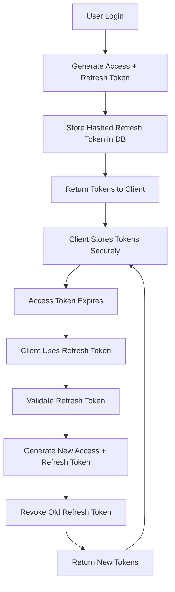

# 🔐 Refresh Token Implementation for Long-Running Sessions

This implementation adds secure refresh token support to your FastAPI backend, solving the daily login problem for your iOS app.

## 🎯 What's Been Implemented

### 1. **Database Schema Updates**
- **New Table**: `refresh_tokens` with secure token storage
- **Indexes**: Optimized for fast lookups and cleanup
- **Security**: Tokens are hashed using SHA-256 before storage

### 2. **Updated Authentication Flow**
- **Login/Signup**: Now returns both access and refresh tokens
- **Token Refresh**: `/auth/refresh` endpoint for seamless token renewal
- **Token Rotation**: Old refresh tokens are revoked when new ones are issued
- **Logout**: Proper token revocation on logout

### 3. **Security Features**
- **Short Access Tokens**: 30 minutes (configurable)
- **Long Refresh Tokens**: 30 days (configurable)
- **Token Hashing**: Refresh tokens stored as SHA-256 hashes
- **Device Tracking**: Optional user agent and IP tracking
- **Automatic Cleanup**: Expired tokens can be cleaned up

## 🔧 Configuration

### Token Lifetimes
```python
ACCESS_TOKEN_EXPIRE_MINUTES = 30  # Short-lived for security
REFRESH_TOKEN_EXPIRE_DAYS = 30    # Long-lived for convenience
```

### Environment Variables
No additional environment variables required - uses existing `SECRET_KEY`.

## 📡 API Endpoints

### Authentication Endpoints

#### `POST /auth/login`
**Request:**
```json
{
    "username": "user123",
    "password": "password123"
}
```

**Response:**
```json
{
    "access_token": "eyJ0eXAiOiJKV1QiLCJhbGciOiJIUzI1NiJ9...",
    "token_type": "bearer",
    "refresh_token": "abc123def456...",
    "expires_in": 1800
}
```

#### `POST /auth/signup`
Same request/response format as login.

#### `POST /auth/refresh`
**Request:**
```json
{
    "refresh_token": "abc123def456..."
}
```

**Response:**
```json
{
    "access_token": "eyJ0eXAiOiJKV1QiLCJhbGciOiJIUzI1NiJ9...",
    "token_type": "bearer",
    "refresh_token": "xyz789uvw012...",
    "expires_in": 1800
}
```

#### `POST /auth/logout`
**Request:**
```json
{
    "refresh_token": "abc123def456..."
}
```

**Response:**
```json
{
    "message": "Successfully logged out"
}
```

#### `POST /auth/logout-all`
Revokes all refresh tokens for the current user.

### Management Endpoints

#### `GET /auth/refresh-tokens/stats`
Returns token statistics for the current user:
```json
{
    "user_id": 1,
    "active_tokens": 2,
    "expired_tokens": 0,
    "revoked_tokens": 1,
    "active_sessions": [
        {
            "id": 1,
            "created_at": "2024-01-15T10:00:00",
            "last_used_at": "2024-01-15T10:30:00",
            "expires_at": "2024-02-14T10:00:00",
            "user_agent": "MyBriefings iOS App",
            "ip_address": "192.168.1.100"
        }
    ]
}
```

#### `POST /auth/cleanup-expired-tokens` (Admin only)
Cleans up expired refresh tokens from the database.

## 🗄️ Database Schema

### refresh_tokens Table
```sql
CREATE TABLE refresh_tokens (
    id SERIAL PRIMARY KEY,
    user_id INTEGER NOT NULL,
    token_hash VARCHAR(255) NOT NULL UNIQUE,
    expires_at TIMESTAMP NOT NULL,
    created_at TIMESTAMP DEFAULT CURRENT_TIMESTAMP,
    last_used_at TIMESTAMP DEFAULT CURRENT_TIMESTAMP,
    is_active BOOLEAN DEFAULT TRUE,
    user_agent VARCHAR(500),
    ip_address VARCHAR(45)
);
```

### Indexes
```sql
CREATE INDEX idx_refresh_tokens_user_id ON refresh_tokens(user_id);
CREATE INDEX idx_refresh_tokens_expires_at ON refresh_tokens(expires_at);
CREATE INDEX idx_refresh_tokens_active ON refresh_tokens(is_active);
CREATE INDEX idx_refresh_tokens_token_hash ON refresh_tokens(token_hash);
```

## 🚀 Deployment Steps

### 1. Run Database Migration
```bash
python migrate_refresh_tokens.py
```

### 2. Update Your iOS App
Your iOS app is already updated with the new token management system.

### 3. Test the Implementation
```bash
python test_refresh_tokens.py
```

### 4. Restart Your Server
```bash
python main.py
```

## 🔒 Security Considerations

### Token Security
- **Access tokens**: Short-lived (30 minutes) to limit exposure
- **Refresh tokens**: Hashed before storage, never stored in plain text
- **Token rotation**: Old refresh tokens are revoked when new ones are issued
- **Secure storage**: iOS app uses Keychain for token storage

### Best Practices Implemented
- ✅ Tokens are hashed before database storage
- ✅ Short access token lifetime
- ✅ Token rotation on refresh
- ✅ Proper token revocation on logout
- ✅ Device/client tracking for audit trails
- ✅ Automatic cleanup of expired tokens

### Optional Enhancements
- **Rate limiting** on refresh endpoint
- **Geolocation tracking** for suspicious activity
- **Email notifications** for new device logins
- **Biometric authentication** for sensitive operations

## 📊 Monitoring and Maintenance

### Token Statistics
Monitor token usage with the `/auth/refresh-tokens/stats` endpoint.

### Cleanup Schedule
Set up a cron job to regularly clean expired tokens:
```bash
# Run daily at 2 AM
0 2 * * * curl -X POST http://localhost:8000/auth/cleanup-expired-tokens
```

### Database Monitoring
Monitor the `refresh_tokens` table size and performance:
```sql
SELECT 
    COUNT(*) as total_tokens,
    COUNT(*) FILTER (WHERE is_active = true) as active_tokens,
    COUNT(*) FILTER (WHERE expires_at < NOW()) as expired_tokens
FROM refresh_tokens;
```

## 🧪 Testing

### Automated Testing
Run the test suite:
```bash
python test_refresh_tokens.py
```

### Manual Testing
1. **Login** - Verify refresh token is returned
2. **API Calls** - Verify access token works
3. **Token Refresh** - Verify new tokens are issued
4. **Old Token** - Verify old refresh token is revoked
5. **Logout** - Verify tokens are revoked

### Load Testing
Test token refresh under load to ensure performance.

## 🔄 Token Lifecycle



## ❓ Troubleshooting

### Common Issues

#### "Invalid or expired refresh token"
- Check token expiration time
- Verify token wasn't revoked
- Ensure token is being sent correctly

#### "Token rotation not working"
- Verify old tokens are being revoked
- Check database constraints
- Monitor token statistics

#### "Database migration failed"
- Check database permissions
- Verify PostgreSQL connection
- Run migration script manually

### Debug Endpoints
- `GET /auth/refresh-tokens/stats` - Check token status
- `GET /health` - Verify server is running
- Check server logs for detailed error messages

## 🎉 Benefits

### For Users
- ✅ **Stay logged in for weeks** - No daily login required
- ✅ **Seamless experience** - Automatic token refresh
- ✅ **Security** - Short-lived access tokens
- ✅ **Multi-device support** - Each device has its own tokens

### For Developers
- ✅ **Industry standard** - OAuth 2.0 compliant refresh flow
- ✅ **Scalable** - Efficient database design
- ✅ **Maintainable** - Clean separation of concerns
- ✅ **Monitorable** - Built-in statistics and logging

This implementation follows security best practices and provides a robust foundation for long-running authentication sessions in your iOS app!
